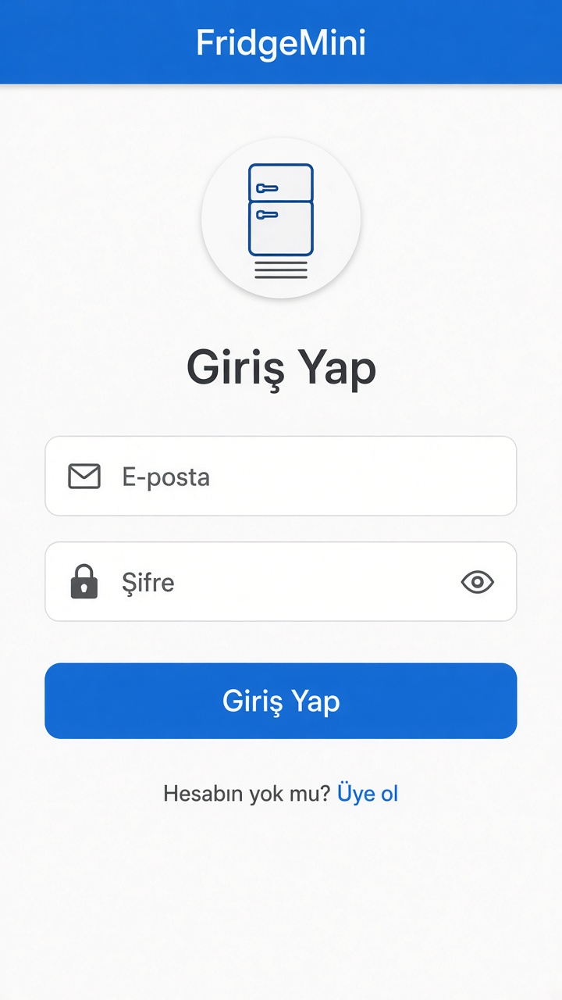
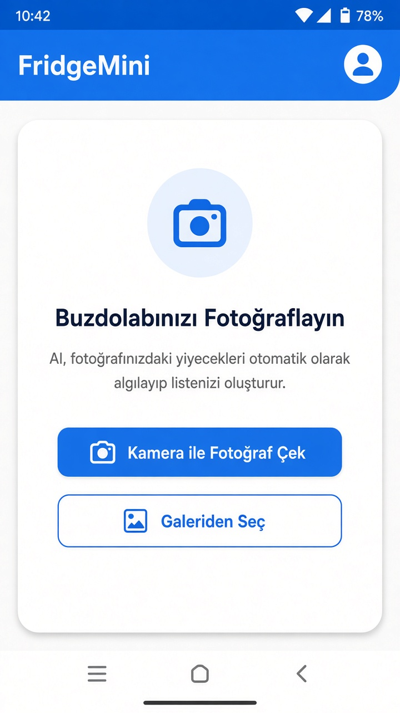
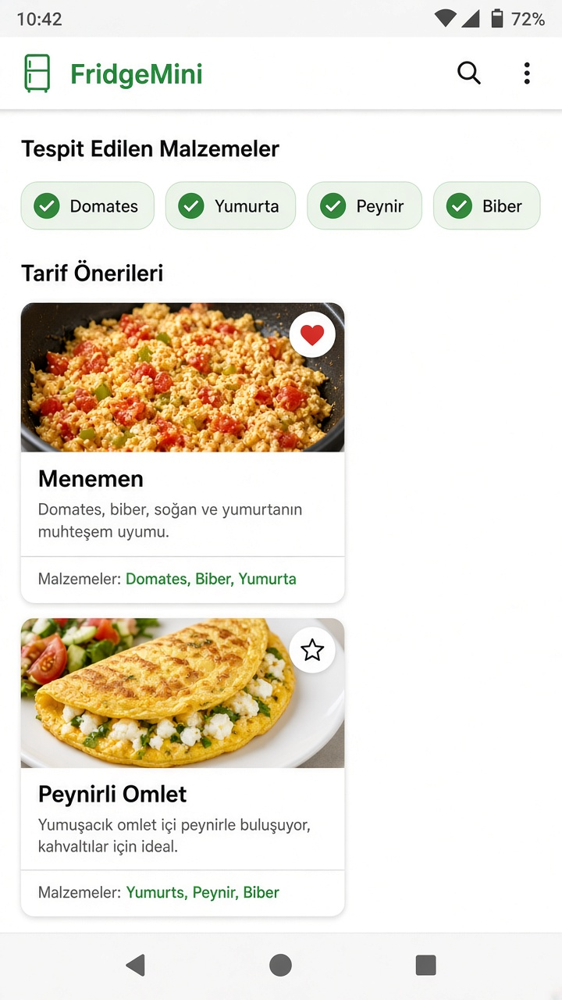

# FridgeMini

Buzdolabı fotoğrafından malzemeleri tespit eden ve Google Gemini ile Türk mutfağı tarifleri öneren Flutter uygulaması.

Firebase ile giriş / kayıt, alerji filtresi, favori tarifler ve Firestore senkronu var. Kamera veya galeriden fotoğraf yüklenir; model malzemeleri listeler, ardından 3–4 pratik tarif üretir.

**Teknoloji:** Flutter, Dart, Firebase Auth, Cloud Firestore, Google Gemini, image_picker, Provider

## Ekran görüntüleri

<p align="center">
  
  
  
</p>

## Çalıştırma

```bash
git clone https://github.com/selinnyuksell5/fridgeMini.git
cd fridgeMini
flutter pub get
flutterfire configure   # Authentication + Firestore
```

`lib/utils/constants.dart` içinde Gemini API anahtarını doldur, sonra:

```bash
flutter run
```

Gemini anahtarı: [Google AI Studio](https://aistudio.google.com/apikey)
